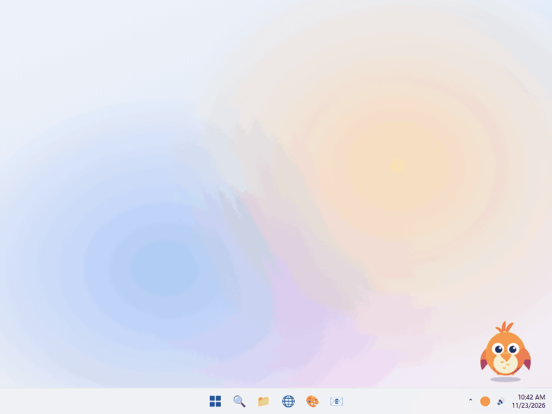

# Aar Desktop – mascot widget for Windows 11

A small eagle (🦅 *Aar*) that sits in the bottom-right corner of the desktop. Clicking it
(or **Ctrl+Alt+A**) opens a speech bubble where you can ask the
[aar agent](https://github.com/fischerf/aar) things in plain language. Aar operates programs, reads
documents, finds photos by their content – and asks for permission in plain words before it
changes anything. Made for office and end users who never open a terminal.

Project page: <https://fischerf.github.io/aar-desktop/> (source: `B:\Github_my\fischerf.github.io\aar-desktop`,
screenshots/GIF generated with [`scripts/showcase`](#website-regenerating-screenshots-and-gif)).




```
aar-desktop.exe (Tauri 2)                          aar (bundled runtime, Python 3.13)
 ├─ src/ (TypeScript, WebView2) ── invoke/events ─┐   python -m aar_desktop.boot acp
 └─ src-tauri/ (Rust)          ── stdio JSON-RPC ─┴──► ACP v1 ──► MCP: Windows desktop · photos · custom servers
                                                               └──► Ollama (local) or any aar provider
```

## Features

**Usage**
- Transparent, frameless window, always on top, not in the taskbar; click = open/close the speech bubble,
  drag = move (position is remembered), resizable (edges / top-left corner)
- Mascot with 10 moods: ready, listening, thinking, answering, working, asking for permission,
  happy, problem, sleeping, offline
- Chat with streaming, safely rendered Markdown, collapsible thoughts, tool calls in plain language
  ("Click "Brush" in Paint") with details; new files of a turn with *Open* / *Show in folder*
- **Permission cards**: *Allow / Deny / Always allow*; working mode per conversation: *Ask first*,
  *Work without asking*, *Read only*; cancel, new conversation, the last session is resumed on start
- Tray icon with menu, single instance, global hotkey, autostart with Windows (HKCU, can be turned off)
- **Languages**: German, English, Simplified Chinese (⚙ → *Language*, default = Windows language),
  including the tray menu and messages from Rust

**Abilities**
- **Operating programs**: the runtime contains aar's Windows desktop MCP server (`tools/windows_mcp`,
  UI Automation). The widget passes it to every session via ACP; Aar asks before every click, every input and every
  program start. Can be turned off under ⚙ → *Abilities*.
- **Images in the chat**: 📎, drag or paste; the widget scales them down to max. 1280 px (JPEG) and sends them as
  ACP image blocks – aar passes them on to vision models (qwen3.8, qwen3.5:4b and gemma4 can see images).
- **Photo search** (⚙ → *Photos*): only explicitly chosen folders (including subfolders). The local vision model
  describes each photo once (sentence, objects, number of people, indoors/outdoors, visible text; measured approx.
  5 s/photo with qwen3.8, 2 s with qwen3.5:4b) into an index under `%LOCALAPPDATA%\de.aar.ui\photos`
  (SQLite + thumbnails). Images with a side < 64 px (icons, sprites, tiles) are found but
  skipped and counted; small images such as 160×144 screenshots are upscaled for the model.
  **Removing a folder immediately deletes its index entries and thumbnails** (`photos prune`); deleted files
  disappear on the next index run; *Delete index* removes everything. The bundled MCP server
  `aar_desktop.photos` provides `photo_search` (English terms + filters), `photo_view`, `photo_index_status`,
  `photo_index_update`; results appear as thumbnails. No face recognition.
  Small photo models can be downloaded directly in the tab (also without a graphics card, then marked): **Qwen 3.5 4B**
  (JSON description) and **Moondream 2 1.8B** (`moondream:1.8b`; cannot fill in the JSON template → simple
  questions, scene/people derived from the description if necessary; the same path is the fallback for any unusable JSON answer).
  Measured CPU-only (2 test photos incl. loading): Sandbox Qwen 33 s / Moondream 21 s, WSL VM (8 cores) 80 s / 40 s.
  With a cloud provider in the chat, the chosen photo model still describes locally (Ollama on `127.0.0.1:11434`).
- **Extensions** (⚙ → *Extensions*): list from the
  [aar extensions registry](https://github.com/fischerf/aar-extensions-registry); install,
  enable/disable, remove. Every extension shows warnings – curated texts plus what it actually registers after
  installation (hooks into actions/messages/history, additional instructions,
  tools with side effects, commands). Risky ones require a second confirmation.
- **Tool servers (MCP)** (⚙ → *Tools*): catalog with a settings dialog (later via *Adjust*) – Python:
  read web pages, read documents (PDF/Word/Excel/PowerPoint), time; Node.js: Playwright (Edge),
  Chrome DevTools (browser, tool scope, headless, own profile, `--no-usage-statistics`), memory.
  Plus custom servers (program + arguments + environment variables, or internet address + HTTP headers).
  A broken server does not take down the others and is reported in the chat.

**Setup**
- **Setup assistant** (opens on first start): detects RAM and graphics card (real VRAM via DXGI),
  recommends a model (≥ 20 GB VRAM → qwen3.8, otherwise gemma4:e4b, weak PCs → qwen3.5:4b), installs
  Ollama silently per user and downloads the model with progress.
- **Language model connection**: profiles from `~/.aar/config.json` or a provider (Ollama, Anthropic, OpenAI,
  Google Gemini, OpenAI-compatible service); server address/model can be overridden, *Test* (Ollama: reachability
  + models; cloud: checks the API key and lists the models). Passed to aar as `--provider`, `--base-url`, `--model`,
  `--config`; the API key (`settings.apiKeys`) only as an environment variable
  (`ANTHROPIC_API_KEY`, `OPENAI_API_KEY`, `GEMINI_API_KEY`, `GENERIC_API_KEY`); the aar configuration is never
  modified. A provider type different from the default profile starts in aar (≥ develop_mcp ed1ecd6) with fresh
  settings instead of inheriting the Ollama profile's address/options. The runtime ships the SDKs for this
  (`anthropic`, `openai`, `google-genai`). When connecting, the widget checks the model server or key.
- **Context indicator** in the header (left of ＋): context size from setting/profile (`context_window`
  or `extra.num_ctx`), after every answer used/total from aar's ACP `usage_update` (the bar turns
  amber at 70 %, red at 90 %).
- **Troubleshooting** (⚙ → *General*): open conversation history and log, copy version info.

## Installation / runtime

- Windows 11 (WebView2 is preinstalled). The installer installs per user without admin rights to
  `%LOCALAPPDATA%\Aar` and ships **aar including Python 3.13** (`python\`: aar wheel, Windows wheels, pip,
  hatchling, Pillow, `windows_mcp`, `aar_desktop`). aar is not installed system-wide (no `aar` on the PATH).
  Silent install: `Aar_<version>_x64-setup.exe /S`.
- **Agent program** (⚙ → *Advanced*): empty = bundled runtime (without it: `aar` from the PATH); otherwise exactly
  this program, e.g. your own editable install of aar.
- **Add-ons are always managed with the Python that runs aar** (`helpers.rs`): the bundled runtime or
  the Python behind the agent program (`…\Scripts\aar.exe` → `…\python.exe`). For this, the Python helpers are
  embedded in the exe and written to `%LOCALAPPDATA%\de.aar.ui\helpers`.
- Anything installed later lives outside the program folder (updates replace it), under `%LOCALAPPDATA%\de.aar.ui\`:
  `extensions\` (pip `--prefix`), `mcp\<id>\` (a separate `pip --target` or `npm --prefix` per server),
  `mcp-data\<id>\` (data such as the memory, deleted on removal), `node\` (portable Node.js LTS, downloaded with
  the first npm server, SHA256-verified), `photos\` (photo index), `logs\aar.log`.
- Settings: `%APPDATA%\de.aar.ui\settings.json` (UTF-8, BOM allowed).
- Command line: `aar-desktop.exe --diagnose <file.json>` (hardware, Ollama, agent),
  `aar-desktop.exe --setup <log> [model]` (unattended setup).

## Development

Building and testing happens **in the WSL VM `Ubuntu-aarui`** (`E:\WSL\Ubuntu-aarui`), cross-compiling to
`x86_64-pc-windows-msvc` (cargo-xwin) and NSIS. The repo on `B:` is the source; the scripts sync it
to `~/build/aar_ui` in the VM. Nothing built is run on the Windows host – Windows tests run in
Windows Sandbox. Rules and pitfalls: [`CLAUDE.md`](CLAUDE.md).

Shortcut by double-click or from the console: **`build.bat`** rebuilds the aar runtime, app and installer
(`build.bat --fast` without a new aar runtime; further options such as `--debug` are passed to `build.sh`). It aborts
while Aar Desktop or an Aar installer from `dist\` is running (otherwise the files would not be overwritten).

```powershell
$env:WSL_UTF8 = 1
# once: toolchain in the VM
wsl -d Ubuntu-aarui -u root -- bash /mnt/b/Github_my/aar_ui/scripts/wsl/setup-dev.sh

# build -> dist\aar-desktop.exe and dist\Aar_<version>_x64-setup.exe
wsl -d Ubuntu-aarui -u root -- bash /mnt/b/Github_my/aar_ui/scripts/wsl/build.sh
#   --python  rebuild the bundled runtime (aar wheel from ../aar; after changes to aar or python/)
#   --debug   debug build (with console)      --icons   regenerate icons from assets/app-icon.svg
```

The program must **not** be called `aar.exe` (Windows looks for programs in their own folder first). If the app
or the installer from `dist\` is running, the files are locked and will not be overwritten.

### Tests

```powershell
# Rust unit tests
wsl -d Ubuntu-aarui -u root -- bash /mnt/b/Github_my/aar_ui/scripts/wsl/test-rust.sh
# UI test: real frontend in headless Chromium with Tauri mock + fake agent (tests/e2e), screenshots in dist\screenshots
wsl -d Ubuntu-aarui -u root -- bash /mnt/b/Github_my/aar_ui/scripts/wsl/e2e.sh
# Installer test in a fresh Windows Sandbox (~10 min): runtime, ACP, all registry extensions, MCP (pip + npm,
# Edge), photo index via the host Ollama, app start, "own aar" (regular Python + aar wheel)
powershell -ExecutionPolicy Bypass -File scripts\sandbox\run.ps1 [-Full] [-KeepOpen]
# drive the real widget via UI Automation (LLM = host Ollama qwen3.8)
powershell -ExecutionPolicy Bypass -File scripts\sandbox\desktop.ps1 -Mode widget -SkipPaint
```

Sandbox data lives outside the repo under `E:\Windows_Sandbox\` (`installer-test\in|out`,
`ollama-models`, `photos` = test photos for the photo index, `pytest\<name>`). Testing without an LLM:
`scripts/mock_acp_agent.py` as the agent program (`python` + path as argument); `scripts/probe_acp.py` shows the
raw ACP messages.

### Website: regenerating screenshots and GIF

The project page exists in English (`aar-desktop/index.html`), German (`de/index.html`) and Simplified
Chinese (`zh/index.html`), with shared `site.css`/`site.js`. On the first visit the English page redirects
to `de/` or `zh/` based on the browser language; a choice made in the switcher is remembered in `localStorage
aar-desktop-lang`. Always change texts on all three pages.

After UI changes, re-capture the images – one set per language. The stage `scripts/showcase/stage.html` shows
a light Windows 11 desktop (taskbar, Paint, Explorer and PDF windows, texts translated via `stage.texts()`)
with the **real frontend** in an iframe; the answers come from a scripted demo agent
(`window.__shimDemo`, texts per language in `TEXT` in `scripts/showcase/capture.mjs`) via the Tauri mock from
`tests/e2e`.

```powershell
# all scenes + GIF in en, de, zh -> dist\showcase\<lang>\*.png (1600x1200) + aar-desktop.gif (800x600)
# and automatically as WebP + GIF to B:\Github_my\fischerf.github.io\aar-desktop\img\<lang>
wsl -d Ubuntu-aarui -u root -- bash /mnt/b/Github_my/aar_ui/scripts/wsl/showcase.sh

# only some scenes (comma-separated, "all" = all) and/or languages:
#   paint, photo-search, vision, permission, extensions, tools, photos-settings, setup, gif
wsl -d Ubuntu-aarui -u root -- bash /mnt/b/Github_my/aar_ui/scripts/wsl/showcase.sh tools,gif de
```

1. Prerequisite: `e2e.sh` has run once (installs Playwright). On the first run `showcase.sh` downloads the font
   *Selawik* (substitute for Segoe UI) and the CC0 sample photos (`fetch_photos.py` → `dist\showcase-src\photos`,
   credits in `credits.json`). All three languages take about 4 minutes.
2. Check the result: look at `dist\showcase\<lang>\*.png`; open the page locally, e.g. in the VM
   `cd /mnt/b/Github_my/fischerf.github.io && python3 -m http.server 8765` → `http://localhost:8765/aar-desktop/`
   (`/de/`, `/zh/`).
3. New UI elements that should appear in a scene: demo answers, prompts and file names in `capture.mjs`
   (`TEXT`, `demoScript`, `scenes()`), desktop windows in `stage.html`. Add new scenes to `publish.py` (`SCENES`)
   and include them on all three pages (section *tour*).
4. Publish the page: commit and push in the `fischerf.github.io` repo.

`SHOWCASE_SITE=""` only produces the files in `dist\showcase`, without touching the website. When `en` is
captured, the English GIF and `photo-search.webp` are also copied to `docs/img` for this README
(`SHOWCASE_README=""` = do not copy).

## Structure

| Path | Contents |
|------|----------|
| `src/main.ts` | UI controller: chat, permission cards, attachments, settings, window, preflight |
| `src/acp.ts` | ACP client (JSON-RPC, sessions, prompts with images, permission requests) |
| `src/addons.ts` | Extensions (registry, warnings) and tool servers (catalog, dialogs) |
| `src/photos.ts` | Photo search: settings tab, result card with thumbnails |
| `src/setup.ts` | Setup assistant |
| `src/tools.ts`, `src/markdown.ts` | Tools in plain language, safe Markdown renderer |
| `src/mascot.ts`, `src/styles.css` | Mascot SVG and moods, Fluent styling light/dark |
| `src/i18n.ts` | Languages de/en/zh: `strings({de,en,zh})` per module, `data-i18n*` in the HTML |
| `src-tauri/src/lib.rs` | Window, tray, hotkey, commands, CLI modes |
| `src-tauri/src/agent_process.rs` | Starting aar, PATH resolution, MCP servers for the session |
| `src-tauri/src/helpers.rs` | Choosing the Python for add-ons, embedded helpers |
| `src-tauri/src/addons.rs`, `photos.rs` | Registry, install/uninstall, MCP servers, photo index, folder picker |
| `src-tauri/src/settings.rs`, `llm_config.rs`, `setup.rs` | Settings, aar profiles, hardware/Ollama |
| `src-tauri/src/i18n.rs` | `tr()` / `trf!` for texts from Rust |
| `python/aar_desktop/` | Helpers: `boot` (aar + extensions), `ext`, `mcp`, `node`, `photos` |
| `scripts/wsl/` | Setup, build, runtime bundle, tests, showcase in the WSL VM |
| `scripts/showcase/` | Stage, capture, GIF, photos and publishing for the website |
| `scripts/sandbox/`, `tests/sandbox/` | Tests in Windows Sandbox |
| `tests/e2e/` | Playwright UI test with Tauri mock + fake ACP agent |

## Next steps

1. Installer signing, public release (the project page's download link still points to the aar releases)
2. Voice input, hints about the active window
3. Photo search: optional local face recognition (opt-in only, model license to be clarified)
