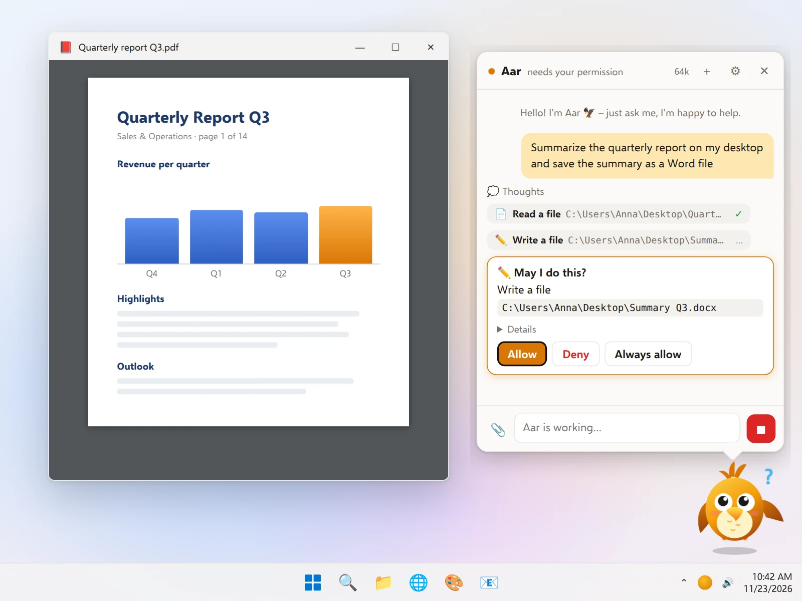
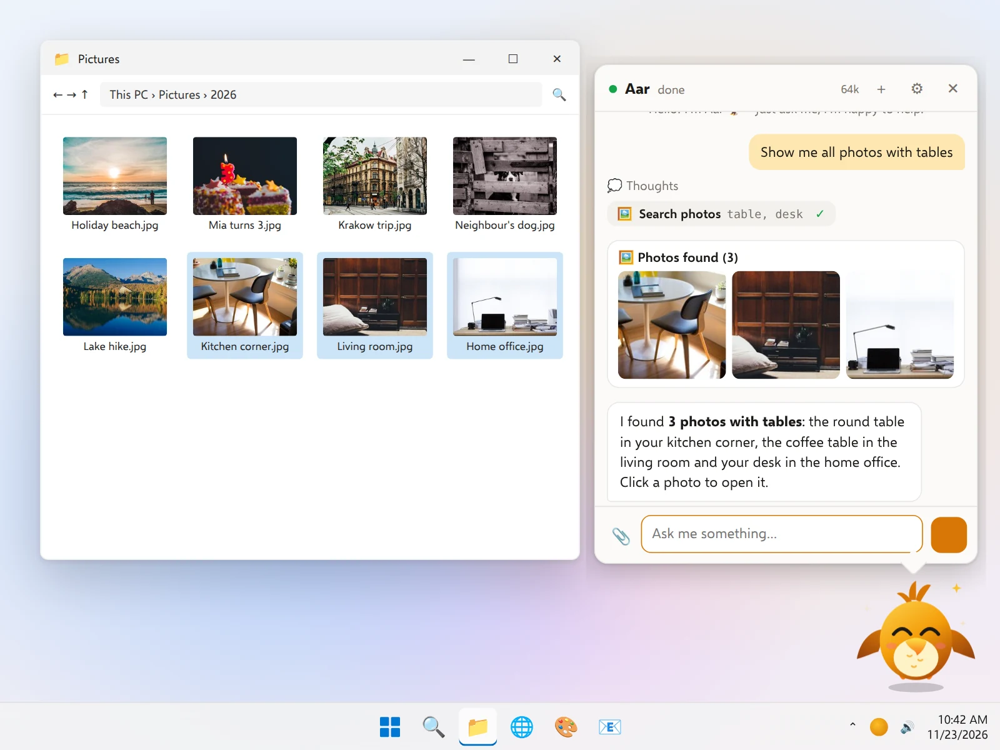
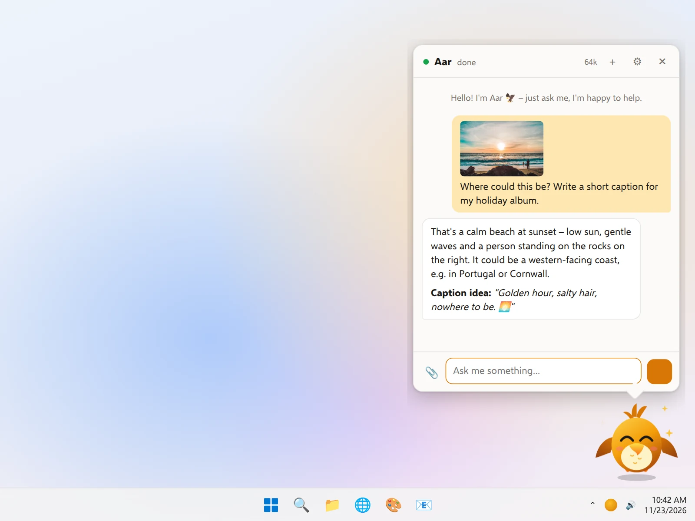
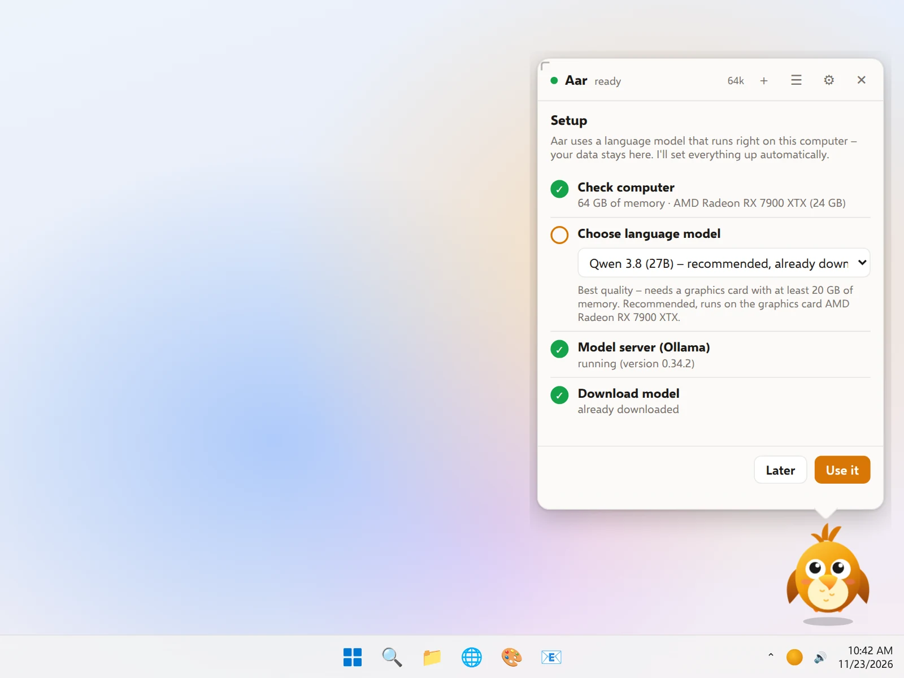

# 🦅 Aar Desktop

**A friendly desktop assistant for Windows 11 (and Linux, preview) – powered by the aar agent**

Made in the EU · local-first · no cloud, no account, no telemetry

> [!WARNING]
> **Early preview.** Aar Desktop is in its first version and will contain bugs. An AI agent that operates programs
> and writes files can make mistakes that are hard to undo – please use it **only in a virtual machine or test
> environment without productive or personal data**, not on your everyday PC.

## What is Aar Desktop?

Aar Desktop puts a small eagle mascot in the bottom-right corner of your screen. Click it – or press
**Ctrl+Alt+A** – and a chat bubble opens where you can simply ask for things in your own words:

> *"Open Paint and paint a sunset over the sea."*
> *"Show me all photos with tables."*
> *"Summarize the quarterly report on my desktop and save the summary as a Word file."*

Aar then operates programs on your PC, reads documents, searches your photos by what is in them and
answers questions about images. Before it changes anything – clicking, typing, saving a file – it asks for
your permission in plain language.

Aar Desktop is made for people who never open a terminal: office workers, families, anyone who would rather
ask than search through menus. By default the language model runs **locally on your own computer**
(via [Ollama](https://ollama.com/)), so your files and photos stay on your PC. If you prefer, you can connect
a cloud provider such as Anthropic, OpenAI or Google Gemini instead.

### Privacy by design

- **Local-first:** with a local model (the default), your messages, files and photos never leave your PC.
  This makes GDPR-compliant use easy.
- **No cloud, no account, no telemetry:** Aar Desktop collects no usage data and does not check for updates. It
  only goes online by itself to download Ollama and the language model during setup, and to load the extension
  list when you open *Extensions*.
- **You stay in control:** cloud providers, web pages and tool servers are only used when you set them up or ask
  for them. With a cloud provider, your messages and the content Aar reads for a task are sent to that provider.
- **Made in the EU** and open source under the Apache License 2.0: you can read every line of what runs on
  your PC.

## Screenshots

<table width="100%">
  <tr>
    <td width="50%" align="center" valign="top">
      
       <b>Asks before it changes anything</b>
    </td>
    <td width="50%" align="center" valign="top">
      
       <b>Finds photos by what is in them</b>
    </td>
  </tr>
  <tr>
    <td width="50%" align="center" valign="top">
      
       <b>Understands the images you give it</b>
    </td>
    <td width="50%" align="center" valign="top">
      
       <b>Sets itself up on the first start</b>
    </td>
  </tr>
</table>

## Installation

1. **Download** the installer `Aar_<version>_x64-setup.exe` from the [Releases page](../../releases).
2. **Run it** – for now inside a virtual machine (see the warning above). It installs for your user account only, needs no administrator rights and brings everything
   it needs along – including the aar agent and its own Python. Nothing else has to be installed by hand.
3. **Follow the setup assistant.** On the first start Aar checks your computer's memory and graphics card,
   recommends a suitable language model, installs Ollama quietly in the background and downloads the model
   while showing the progress. After that, the eagle is ready – just click it and ask.

**Requirements:** Windows 11 (64-bit). A graphics card with plenty of video memory makes Aar faster, but it
also works on PCs without one – just more slowly. Instead of a local model you can configure a cloud or custom
provider (such as Anthropic, OpenAI, Google Gemini or a custom API gateway) directly in the setup assistant or
under ⚙ → *Language model connection*.

Aar starts automatically when you sign in to Windows (you can turn this off in the settings). To uninstall
it, use *Settings → Apps* in Windows like for any other program.

### Linux (preview)

Linux packages are on the [Releases page](../../releases) as well – they bring the aar agent and its own Python
along, like the Windows installer:

- **AppImage** `Aar_<version>_amd64.AppImage` – one file for most distributions: make it executable
  (`chmod +x`) and start it.
- **rpm** `Aar-<version>-1.x86_64.rpm` – Fedora, openSUSE and others.
- **tar.gz** `Aar_<version>_x86_64.tar.gz` – unpack it anywhere and run `./install.sh` (menu entry, command
  `aar-desktop`). Needs WebKitGTK 4.1 (`sudo apt install libwebkit2gtk-4.1-0 libayatana-appindicator3-1` on
  Ubuntu/Kubuntu).

Requirements: x86-64 with glibc 2.35 or newer (e.g. Ubuntu/Kubuntu 22.04+, Debian 12+, Fedora 36+). The setup
assistant installs Ollama without root rights into `~/.local` and starts it when Aar starts.

Not on Linux yet: **operating other programs** (reading windows, clicking, typing – the Paint example). Aar works
with files, commands (bash) and, with the web add-ons, web pages. The widget runs through XWayland so it can stay
in the bottom-right corner; on Wayland a global shortcut may only work while Aar is in front – add a shortcut for
the command `aar-desktop` in the system settings instead (starting it again opens and closes Aar).

## Features

- **Operates programs for you** – opens apps, clicks buttons, types text and reads what is on the screen,
  using Windows UI Automation.
- **Always asks first** – every change appears as a card with *Allow* or *Deny*; you can also allow an action
  for the conversation or permanently (never for commands or deleting) and revoke it any time under ⚙. You can
  also choose *Ask first*, *Work without asking* or *Read only* per conversation.
- **Earlier conversations** – continue or delete saved conversations from the list in the header.
- **Photo search** – describes the photos in folders you choose, once and locally, so you can later find
  them by content ("photos with a dog", "pictures from the beach").
- **Images in the chat** – attach, drag or paste a picture and ask about it.
- **Reads documents and web pages** – PDF, Word, Excel and PowerPoint via optional tool servers.
- **Extensions and tool servers (MCP)** – add new abilities from a curated catalog with clear warnings, or
  connect your own servers.
- **Shows its work** – tool calls in plain language ("Click 'Brush' in Paint"), collapsible thoughts, and
  *Open* / *Show in folder* for every new file.
- **A mascot with moods** – ready, listening, thinking, working, asking for permission, happy, sleeping and
  more, so you always see what Aar is doing.
- **Speaks your language** – English, German and Simplified Chinese.
- **Local first** – once set up, it works without an internet connection using Ollama; cloud providers are
  optional.

The [user manual](docs/manual.md) explains every feature and setting in detail. If you want to build Aar
Desktop yourself or contribute, see the [developer guide](docs/development.md).

## What is aar?

[**aar**](https://github.com/fischerf/aar) (*Adaptive Action & Reasoning Agent*) is the agent that does the
actual work behind the mascot: a lean, provider-agnostic agent framework with a thin core loop, sandboxed tool
execution, extensions and support for the [Model Context Protocol](https://modelcontextprotocol.io/).
It can also be used on its own from the command line or in code editors such as Zed and VS Code.

Aar Desktop is a friendly front end for aar on Windows. It talks to the agent through the
[Agent Client Protocol (ACP)](https://agentclientprotocol.com/) and gives it a Windows desktop tool server,
so the agent can see and operate your programs. Learn more on the
[aar website](https://fischerf.github.io/aar/).

## Disclaimer

Aar Desktop is free, open-source software provided **"as is", without warranty of any kind**, as set out in the
[Apache License 2.0](LICENSE). **You use it at your own risk.**

Aar Desktop lets an AI agent operate programs, write files and run commands on your computer. Language models
make mistakes, and actions you allow can change or delete data, send messages or cause other effects that cannot
be undone. To the extent permitted by applicable law, the author is not liable for any damage, data loss or other
consequences arising from the use of this software. Read every permission request before you allow it, keep
backups, and do not use Aar Desktop with productive, sensitive or personal data.

Third-party components – language models, Ollama, cloud providers, extensions and tool servers – are subject to
their own licenses and terms of use.

## Author

**Florian Fischer**

## License

Apache License 2.0
